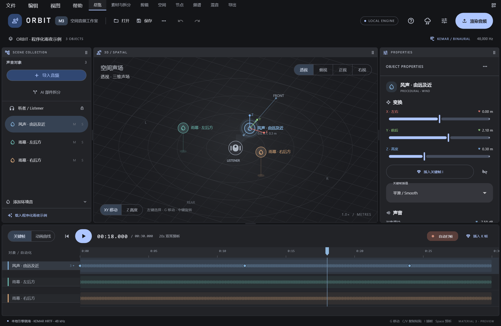
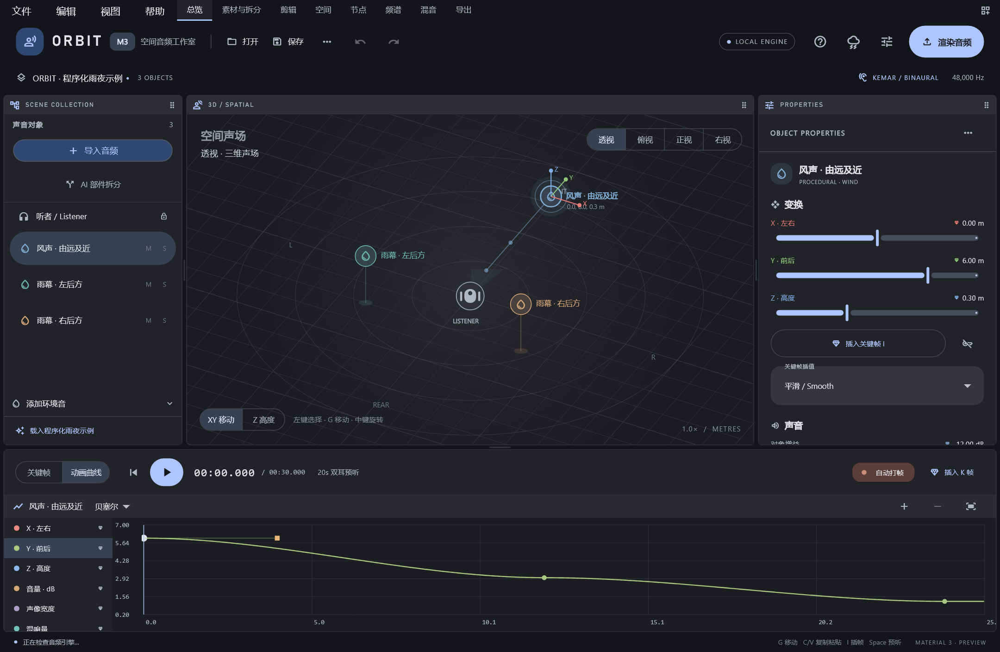
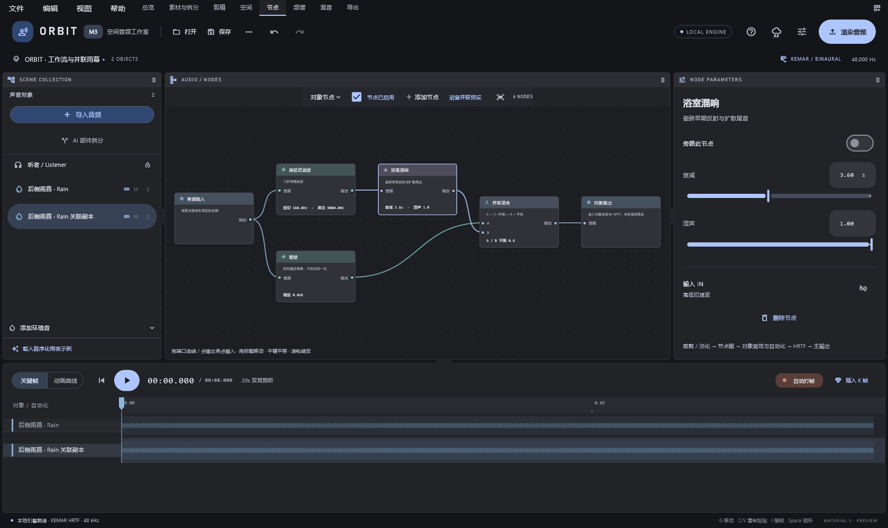
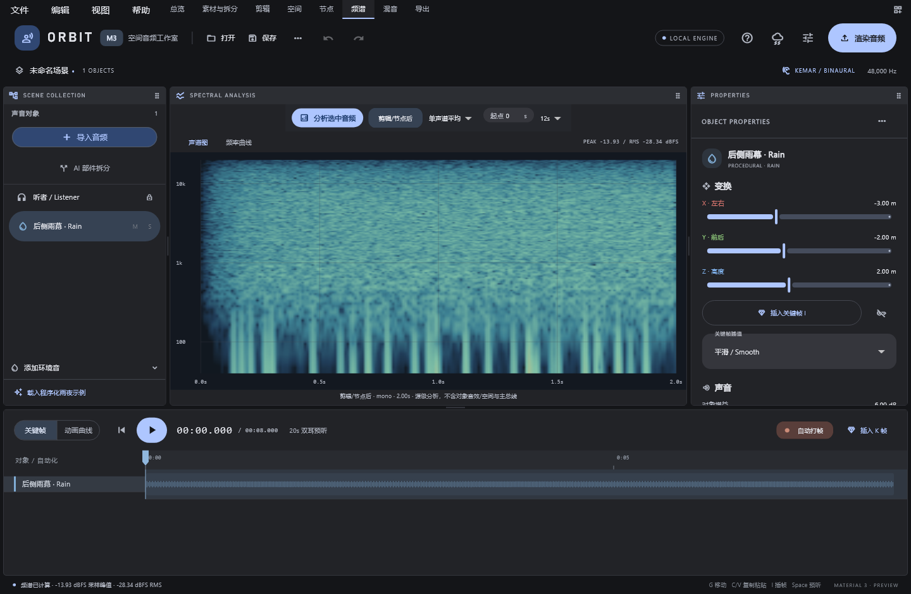

# ORBIT (`orbit-audio`)

[](https://github.com/Eyeing0721/orbit-audio/releases)
[](https://github.com/Eyeing0721/orbit-audio/releases)
[](https://flutter.dev/)
[](LICENSE)
[](https://orbit-audio.pages.dev/)

> **首次公开发布 · 初版**（具体版本号：`0.7.1`）

你好呀，欢迎来到 **ORBIT**！

ORBIT 是一款使用 Flutter 编写的本地双耳空间音频编辑器，目前主要面向 Windows 平台。做这个工具的初衷很单纯：希望让想尝试空间音频创作的朋友，不必依赖付费商业数字音频工作站（DAW），就能在本地电脑上用直观的三维视角和节点流程，把声音安放在立体空间里。

无论你是想做一段有声故事、独立游戏环境音、播客空间化片段，还是想用脚本批量处理音频工程，都希望 ORBIT 能成为你趁手的小工坊。

---

## 目录

- [界面与预览](#界面与预览)
- [主要能力](#主要能力)
- [工作流概览](#工作流概览)
- [运行环境与外部依赖说明](#运行环境与外部依赖说明)
- [获取与启动](#获取与启动)
- [已知限制与边界说明](#已知限制与边界说明)
- [文档导航](#文档导航)
- [许可证与第三方资源核验说明](#许可证与第三方资源核验说明)

---

## 界面与预览

以下图片由实际 Flutter 组件测试离屏渲染生成，使用程序化或合成素材；不是设计稿，也不是原生 Windows 窗口截图。









[开屏动画帧](docs/images/splash.png) · [首次引导](docs/images/onboarding.png) · [空工程](docs/images/empty.png)

---

## 主要能力

### 1. 借鉴三维软件习惯的界面与工程组织
- **深灰色 Material 3 界面**：降低长时间编辑音频时的视觉疲劳。
- **三维对象式交互**：借鉴 Blender 的对象操作与工作区组织方式，将声音视为三维空间中的对象进行选中、移动、复制与关键帧动画编排。
- **灵活的面板调整**：支持拖动调整面板大小、拖动面板标题交换编辑区域（注：采用固定框架下的区域调整与交换，非任意分割、合并或浮动窗口）。
- **单文件工程（`.orbit`）**：所有工作流共享同一个工程实例，`.orbit` 单文件工程可将三维场景、音频素材及所需的空间化资源（如卷积资源、文件节点素材等）统一打包，方便备份与迁移。

### 2. 素材导入、AI 分轨与基础剪辑
- **多格式音频与视频音轨提取**：支持导入多种常见音频格式；在配置好 FFmpeg 的前提下，可直接从含音轨的视频容器中导入声音。
- **Demucs 音源分轨**：支持调用 Demucs 进行音轨分离，已接入 `htdemucs`、`htdemucs_ft`、`htdemucs_6s` 模型，可按需选择模型及需要保留的声音部件，支持使用 CPU 或兼容的 GPU 进行计算。
- **基础剪辑与处理**：支持调整剪辑范围、淡入淡出、反向、变速、归一化与极性反转（注：变速会同时改变音高，并非保持音高的时间拉伸）。

### 3. 双耳空间化与关键帧动画
- **KEMAR SOFA HRTF 双耳空间化**：使用 KEMAR SOFA HRTF 数据将三维空间中的声音对象渲染为双声道双耳空间音频。
- **自由的空间叙事**：声音不必绕着听者做机械旋转——你可以制作远处人声慢慢走近、乐器分布在两侧后方、或是四周被雨幕包裹的静止与动态场景。
- **多参数关键帧与曲线插值**：支持对位置、音量、扩散、混响、回声、失真等参数打关键帧；底部面板可在**关键帧编辑器**与**动画曲线编辑器**之间切换，支持**阶跃**、**线性**、**平滑**和**贝塞尔曲线**插值。

### 4. 双层节点图与程序化环境音
- **对象级与总线级节点图**：支持在单音频对象层级和双耳混合后的立体声总线层级搭建节点图，提供连接、分支、旁路、删除与撤销操作。
- **19 种内置节点**：涵盖输入、输出、增益、滤波器、均衡器、压缩器、噪声门、回声、混响、失真、混合、HRTF 空间化、合唱、微移调、扩散器、卷积、环境音、文件输入与侧链闪避。
- **内置程序化环境声源**：环境音节点生成程序化雨声、风声、海浪、粉红噪声、白噪声；外部素材使用独立的文件输入节点。

### 5. 离线频谱分析与多格式导出
- **源音频 STFT 分析**：支持手动计算源音频的短时傅里叶变换（STFT）频谱，提供频谱视图、频谱热图与频率曲线观察。
- **多格式离线导出**：主输出为 `48 kHz` 双声道双耳空间音频，支持导出 `WAV`、`FLAC`、`AIFF`、`CAF`、`W64`、`MP3`、`AAC`、`ALAC`、`Opus`、`Vorbis` 等格式，可选 24 位无损、32 位浮点及部分有损编码配置，并在最终输出阶段提供采样峰值保护。

### 6. 命令行与本地 HTTP API 自动化
- 提供面向开发者的命令行工具（涵盖 `doctor`、`inspect`、`analyze`、`run`、`project`、`render`、`separate`、`serve` 命令类别）以及需主动启用的本地回环 HTTP API，方便集成至批处理流程。

---

## 工作流概览

ORBIT 顶栏提供 **文件、编辑、视图、帮助** 菜单，下方通过 8 个工作流选项卡组织创作全流程。所有选项卡操作的是**同一个工程**，随时切换都不会丢失上下文：

| 工作流选项卡 | 核心职责简述 |
| :--- | :--- |
| **1. 总览** | 查看与管理当前 `.orbit` 工程的整体状态、资源概况与基础信息。 |
| **2. 素材与拆分** | 导入音频或视频音轨，管理工程素材，并使用 Demucs 模型执行分轨拆分。 |
| **3. 剪辑** | 对音频素材进行剪辑范围裁切、淡入淡出、反向、变速、归一化与极性反转。 |
| **4. 空间** | 在三维视图中摆放声音对象，结合底部关键帧与动画曲线编辑器制作空间位置与参数动画。 |
| **5. 节点** | 编辑对象级节点图与总线级节点图，串联 19 种音频处理、空间化与生成节点。 |
| **6. 频谱** | 手动触发计算源音频的 STFT 频谱，查看频谱热图与频率曲线。 |
| **7. 混音** | 平衡各声音对象与整体总线的听感，配合离线试听进行调整。 |
| **8. 导出** | 配置输出格式与编码位深，执行离线渲染并输出最终音频文件。 |

---

## 运行环境与外部依赖说明

- **目标平台**：目前主要面向 Windows 系统。
- **分发形态**：采用 **Windows 便携压缩包** 形式分发（非安装程序）。
- **外部工具与模型说明（重要）**：
  - **Python 处理环境**、**FFmpeg** 以及 **Demucs 分轨模型权重**（`htdemucs`、`htdemucs_ft`、`htdemucs_6s`）**不应默认视为已包含在应用便携包中**。
  - 若需使用视频容器音轨导入、部分转码或 Demucs 音轨分离功能，请确保本地已按要求配置好对应的 Python 环境、FFmpeg 及模型权重文件。（可使用 `orbit.cmd doctor` 检查依赖；配置方式见下方“获取与启动”。）

---

## 获取与启动

[首次发布页面](https://github.com/Eyeing0721/orbit-audio/releases/tag/v0.7.1) · [Windows x64 便携包 ORBIT_Windows_0.7.1.zip](https://github.com/Eyeing0721/orbit-audio/releases/download/v0.7.1/ORBIT_Windows_0.7.1.zip) · [源码压缩包](https://github.com/Eyeing0721/orbit-audio/releases/download/v0.7.1/ORBIT_Source_0.7.1.zip) · [SHA-256 校验清单](https://github.com/Eyeing0721/orbit-audio/releases/download/v0.7.1/SHA256SUMS.txt)

便携包体积见发布页面的资产信息，下载后可对照校验清单检查文件完整性。

解压整个便携包后运行 `orbit_audio.exe`，不要只复制 EXE。目录中的 `data/`、DLL、`app/backend/`、`app/assets/` 和 `app/projects/` 均需保留。

音频导入、程序化环境音、分析、试听和渲染都需要 Python 音频引擎。推荐 Python 3.11（开发验证版本）。在解压目录打开 PowerShell：

```powershell
powershell -NoProfile -ExecutionPolicy Bypass -File .\scripts\setup_engine.ps1 -Python python
.\orbit.cmd doctor
.\orbit_audio.exe
```

脚本会创建 `app/runtime/` 虚拟环境并安装 `app/backend/requirements.txt` 中的依赖，需要联网。源码目录运行时使用同一脚本，虚拟环境位置为 `runtime/`。它使用 `--system-site-packages`，可复用已有 Python 环境中的包。

FFmpeg 不随包分发。把可信来源的 FFmpeg 加入 PATH，或在启动 ORBIT 的同一个 PowerShell 窗口中设置：

```powershell
$env:ORBIT_FFMPEG = 'C:\Tools\ffmpeg\bin\ffmpeg.exe'
.\orbit_audio.exe
```

也可以放在便携包的 `app/tools/ffmpeg.exe`（源码目录为 `tools/ffmpeg.exe`）。可使用 `ORBIT_PYTHON` 指定 Python 解释器；有该设置时优先于本地虚拟环境。部分无损文件由 SoundFile 直接读写，其他解码和 MP3/AAC 等编码依赖 FFmpeg，实际支持取决于其构建。

Demucs 模型权重首次分轨时按需下载，不包含在便携包内。默认使用 PyTorch 缓存目录中的 `hub/checkpoints/`；可通过 `TORCH_HOME` 调整缓存根目录。`auto` 在 CUDA 可用时使用 GPU，否则使用 CPU；GPU 需要匹配硬件和驱动的 PyTorch，环境安装脚本不保证自动配置 CUDA。

已验证开发环境为 Windows 11 x64；尚未完成其他 Windows 版本及硬件配置的兼容性矩阵，暂不承诺最低 CPU、内存或显存规格。

若提示缺少 MSVC 运行库 DLL，请安装 [Microsoft 官方 Visual C++ x64 运行库](https://learn.microsoft.com/en-us/cpp/windows/latest-supported-vc-redist?view=msvc-170)。便携包不自带此安装程序；Flutter Windows 的分发要求见 [官方说明](https://docs.flutter.dev/platform-integration/windows/building#building-your-own-zip-file-for-windows)。

源码构建已验证工具链为 Flutter 3.47.9 / Dart 3.13.7 与 Visual Studio 2022 的“使用 C++ 的桌面开发”工作负载。准备好工具链后，在源码根目录运行 `flutter pub get`，再执行 `powershell -NoProfile -ExecutionPolicy Bypass -File .\scripts\build_release.ps1 -Flutter flutter -Destination .\dist\ORBIT`。需要先按上文准备 Python 引擎；音频依赖不由 Flutter 打包。

首次启动 ORBIT 时，程序会播放开屏动画、展示操作引导，并自动创建一个空工程，你可以直接开始熟悉界面。

---

## 已知限制与边界说明

为了让每位创作者在投入时间前清楚了解 ORBIT 是否符合自己的需求，这里诚实地列出初版的设计边界与限制：

1. **离线试听与离线渲染架构**：ORBIT 支持离线试听和离线渲染，**不是实时低延迟音频工作站（Real-time Low-latency DAW）**，不适用于现场实时演出或超低延迟监听录音。
2. **双耳空间音频 ≠ Dolby Atmos**：ORBIT 输出的是基于 KEMAR SOFA HRTF 的 `48 kHz` 双声道双耳空间音频（适合耳机聆听），**不支持 Dolby Atmos ADM/JOC 导出，也没有任何杜比（Dolby）官方认证**。
3. **变速同时改变音高**：剪辑工作流中的“变速”采用速度与音高联动的处理方式，加速会使音高变高、减速会使音高变低，**并非保持原音高的独立时间拉伸（Time-stretching）**。
4. **节点参数为静态设置**：虽然空间工作流支持对位置、音量、扩散、混响、回声、失真等参数打关键帧，但**节点图（Node Graph）内部各节点的参数目前均为静态设置**，不支持对所有节点参数添加关键帧动画。
5. **总线级节点图限制**：总线级节点图作用于双耳混合后的立体声信号，因此**不提供 `HRTF 空间化`、`文件输入`、`环境音` 节点**。
6. **非实时频谱与非响度认证分析**：频谱工作流为手动计算的源音频 STFT 分析，**不是实时频谱仪，也不是完整的总线响度分析仪**。
7. **采样峰值保护边界**：导出阶段带有最终采样峰值保护，但**不属于真峰值（True Peak）限制器、不执行 LUFS 响度标准化，也不代表符合广播响度认证标准**。
8. **面板布局方式**：支持调整面板尺寸与拖动标题交换区域，但**不支持像 Blender 那样任意拆分网格、合并窗口或弹出独立浮动窗口**。

---

## 文档导航

仓库内置了详细的分主题文档，欢迎按需查阅：

- 📘 **[用户操作指南 (`USER_GUIDE.md`)](./USER_GUIDE.md)**：从首次启动空工程、导入素材、三维摆位到最终导出的完整操作手册与快捷键速查。
- 🧭 **[工作流详解与实战示例 (`WORKFLOWS.md`)](./WORKFLOWS.md)**：8 个工作流选项卡的详细职责说明，以及一个使用自有录音与程序化环境音制作的空间音频案例。
- 🔗 **[节点参考手册 (`NODES.md`)](./NODES.md)**：对象级与总线级节点图机制、全部 19 种节点的用途解析、连接思路与限制说明。
- ⚙️ **[自动化与接口说明 (`AUTOMATION.md`)](./AUTOMATION.md)**：命令行入口、完整生成帮助、本地 HTTP API 路由和安全机制。
- 🚀 **[首次发布说明 (`RELEASE_NOTES.md`)](./RELEASE_NOTES.md)**：首次公开发布 · 初版的能力汇总、已知限制与发布核验说明。

---

## 许可证与第三方资源核验说明

> **[发布前合规与授权核验提醒]**
> - 本项目仓库的代码许可证、内置/引用的第三方开源组件（包括但不限于 Flutter 及相关插件、FFmpeg、Demucs 及其预训练模型）以及 **KEMAR SOFA HRTF 数据集** 各自适用独立的许可证与使用条款。
> - 在未完成完整授权条款核验前，**请勿将本项目及所涉外部组件、HRTF 数据默认视为“全部采用 MIT 协议”或“可无限制用于任何商业用途”**。
> - 如果你计划将基于 ORBIT 导出的作品、二次分发包或相关资源用于商业场景，请务必先行核验各上游依赖与 HRTF 数据集的原始授权文件。
> - ORBIT 应用代码采用 [MIT 许可证](LICENSE)。第三方组件与 HRTF 数据保留各自授权，见 [第三方声明](THIRD_PARTY_NOTICES.md) 和 [随包许可证](third_party/)。KEMAR 数据来源与作者署名已在声明中列明，不能把它与 MIT 开源许可证混为一谈。
